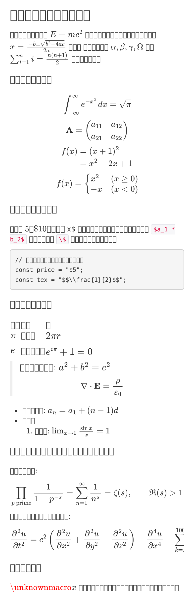

# 🧩 Box Markdown Preview

Morphe patches for [Box for Android](https://play.google.com/store/apps/details?id=com.box.android)
that make the Markdown preview render TeX math and follow the app's dark theme.

| Light | Dark |
| :---: | :---: |
|  |  |

## ❓ About

Box previews `.md` files in a WebView that runs a bundled copy of
[Showdown](https://github.com/showdownjs/showdown). That page knows nothing about
math, and it is hard-wired to a white background.

This patch replaces the preview page inside the APK with a version that

- finds `$…$`, `$$…$$`, `\(…\)` and `\[…\]` in the Markdown before Showdown runs,
  so that `_`, `*` and `\\` inside a formula survive,
- draws each formula with [MathJax 3](https://www.mathjax.org) SVG output,
  which needs no extra font files in the WebView,
- follows Box's night mode through `prefers-color-scheme`, and
- leaves everything that is not a formula alone: no code, table or heading style
  is changed, and code blocks keep their `$` as plain text.

Only files under `assets/showdown/` are touched. No bytecode is patched, so the
patch does not depend on obfuscated class names and does not break when Box
changes its Java code.

> This project has no connection to the Morphe open source project, Box, or Box,
> Inc. They do not endorse it and did not write it.

## 🩹 Patches list

> **[v1.0.0](https://github.com/haya9924/box_md_preview/releases/tag/v1.0.0)**&nbsp;&nbsp;•&nbsp;&nbsp;`main`&nbsp;&nbsp;•&nbsp;&nbsp;1 patch total

**🎯 Supported versions:**

| 7.6.732 |
| :---: |

| 💊&nbsp;Patch | 📜&nbsp;Description | ⚙️&nbsp;Options |
|----------|----------------|-----------|
| Markdown math preview | Renders TeX math in Markdown previews, like Obsidian does. Adds the dark theme to the preview too. |  |

## 📲 Install

1. Get `patches-1.0.0.mpp` from [Releases](https://github.com/haya9924/box_md_preview/releases).
2. Get Box `7.6.732` yourself (`com.box.android`, `.apkm` or `.apk`).
3. Patch it with the [Morphe CLI](https://github.com/MorpheApp/morphe-cli):

   ```bash
   java -Xmx5g -jar morphe-cli.jar patch Box.apkm \
       -p patches-1.0.0.mpp \
       -e "Markdown math preview" \
       --striplibs=arm64-v8a \
       -o Box-7.6.732-math.apk
   ```

   `--striplibs=arm64-v8a` keeps only the 64-bit ARM libraries, which turns a
   730 MB APK into a 300 MB one. Drop it if you need other ABIs.
4. Uninstall the Play Store build (the signature changes), then install the patched APK.

Morphe Manager can load the same `.mpp` file if you prefer a GUI.

## 🛠 Build

The Gradle build needs the Morphe patch registry, which lives on GitHub Packages.
Create a token with `read:packages` and pass it through the environment only:

```bash
export GITHUB_ACTOR=<your-github-user>
export GITHUB_TOKEN=<token with read:packages>

./gradlew :patches:buildAndroid
```

The bundle lands in `patches/build/libs/patches-<version>.mpp`.

`./gradlew generatePatchesList` refreshes `patches-list.json`, the machine-readable
list of patches that third-party tools read.

The preview page lives in `patches/src/main/resources/boxmarkdown/`. To try a
change in a desktop browser, unpack Box's `assets/showdown/` next to it and open
`index.html`.

## 🔍 How it works

| Step | File |
|------|------|
| Hold out code fences and inline code, then pull `$…$` out of the Markdown | `math-preview.js` |
| Replace each formula with a private-use placeholder, run Showdown | `math-preview.js` |
| Swap the placeholders back for MathJax SVG nodes inside the rendered DOM | `math-preview.js` |
| Show the TeX source instead if MathJax never loads | `math-preview.js` |
| Dark colours for body, headings, links, code, quotes and tables | `index.html` |

MathJax adds a hidden MathML copy of every formula for screen readers. MathJax's
own stylesheet is not injected when `startup.typeset` is off, and in Box's WebView
that copy became visible, so every formula appeared twice. The patch disables the
copy, removes it from the DOM, and hides it in CSS as a last resort.

## 📝 Notes

- Display math is centred; a formula wider than the screen scrolls sideways.
- A formula that MathJax cannot parse is shown as its TeX source, never hidden.
- The patched APK is re-signed, so Play Integrity may notice. Box sign-in and
  file previews worked on a Pixel-class device during development, but that is
  not a promise for every device or account.

## 📄 Licence

MIT, see [LICENSE](LICENSE).

The source in this repository is MIT. Two things it ships keep their own terms:

- The built `.mpp` links the [Morphe patches library](https://github.com/MorpheApp),
  which is GPLv3, so the bundle as a whole is passed on under GPLv3
  (see [NOTICE](NOTICE) for the Morphe name restriction).
- The bundled MathJax build is Apache-2.0; its licence text is shipped inside the
  patch bundle as `MathJax-LICENSE.txt`.

Box's own preview assets remain the property of Box, Inc.; the patch only ships
the small page that replaces them.

## 🚀 Release

Releases are cut from tags. Push a tag and the workflow builds the bundle,
creates a draft release, uploads `patches-<version>.mpp`, and publishes it:

```bash
git tag v1.0.0
git push origin v1.0.0
```

`gradle.properties` holds the version that ends up in the `.mpp` file name and in
`patches-list.json`, so bump it before tagging.
